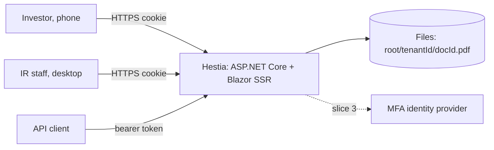

# Architecture

## Style and why
Advisor output (traits: MultiTenant, RegulatoryAudit, PersonalData, ReadHeavy, SeveralBusinessAreas, SmallTeam):

### Recommendation: ModularMonolith

Several business areas need clear boundaries, but one deployment and one database keep it cheap to run and easy to hand over.

#### Patterns
- **AuditTrail**: Keep an immutable record of who did what and when; regulators and clients will ask.
- **CachedReadModel**: Serve searches from a separate, cached read side so reads never slow down writes.
- **PersonalDataProtection**: Collect the minimum, encrypt it, log who read it, and be able to delete it (POPIA/GDPR).
- **TenantIsolation**: Tie every request and query to one tenant, with automated tests proving tenants never see each other's data.

#### Closest reference systems
- Software sold to many companies (CRM) (similarity 0.50): Modular monolith that keeps each company's data separate.
- Banking / payments app (similarity 0.38): Modular monolith with an append-only ledger.
- Video or music streaming (similarity 0.25): Microservices with a CDN for the media itself and an event stream for playback events.

#### Risks to watch
- Modules decay into a big ball of mud unless boundaries are enforced by tests (no cross-module database access).
- One missing tenant filter leaks a client's data. Enforce it centrally, never per query.

#### Evolve when
- One module needs to scale or deploy on a different schedule: extract only that module as a service.
- Separate teams own separate modules and block each other's releases.
- Search becomes the bottleneck: move it to a dedicated search service.

Record the final choice with write_adr, including what you rejected.

Judgement: Build a modular monolith (documents, capital accounts, notices) with tenant isolation enforced centrally and tested. See `decisions/0001-architecture-style.md`.

## Context

## Modules and boundaries
| Module | Project | Owns | May call |
|---|---|---|---|
| Tenancy (kernel) | `src/Modules/Tenancy` | `TenantId`, `ITenantContext` (from the `tenant_id` claim), `TenantScopedStore` (the only tenant-owned data store), `ITenantScopeFactory` | nothing |
| Investors | `src/Modules/Investors` | investor entities (tenants), investor users, revoke/restore | Tenancy |
| Documents | `src/Modules/Documents` | document metadata, files under `<root>/<tenant>/`, publish rules, `StatementPdf`, audited download | Tenancy, Audit block |
| Host | `src/Hestia.Api` | Blazor components, minimal APIs, security wiring, IR actions, notifications on publish, demo seeding | everything |

Investors and Documents never reference each other; implementations are `internal`; architecture tests enforce both.
Capital accounts and notices become modules in later slices.

## Cross-cutting
- **Auth:** Auth block (opaque bearer tokens). Browsers carry the token in the HttpOnly `hestia_session` cookie (ADR-0003). `RevokedUserGuard` decorates the block's stamp check. No self-registration.
- **Tenancy:** central filter, ADR-0004. Tests: `Architecture/TenantFilterTests`, `Acceptance/TenantIsolationTests`.
- **Audit:** Audit block, append-only and hash-chained; `document.downloaded` is written before the file is sent.
- **Notifications:** Notifications block (in-app) through the Outbox block.
- **Errors, health, correlation ids, rate limits:** Web block (ProblemDetails, `/health/live`, `/health/ready`).
- **Building blocks:** vendored `.nupkg` files in `eng/packages` (ADR-0002).
- **Config:** `Documents:Root`, `Documents:MaxBytes`, `Demo:Password`, `Demo:Seed` (see `.env.example`).
- **Design dossier:** `docs/DESIGN.md`.
