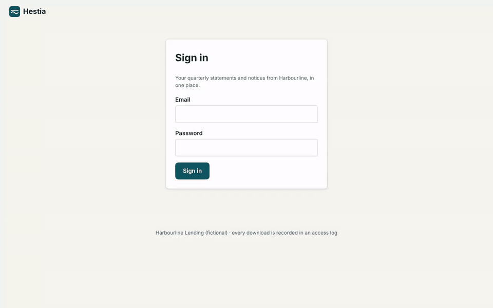
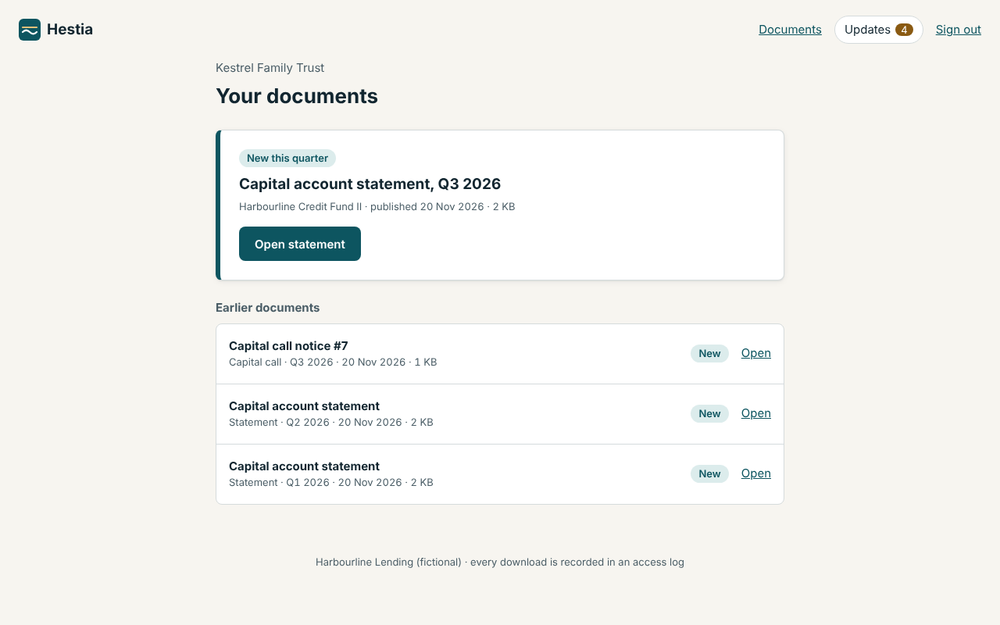
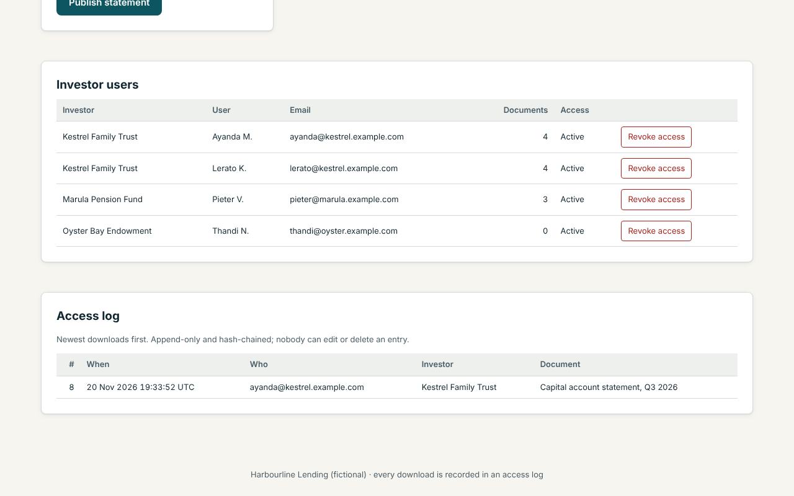
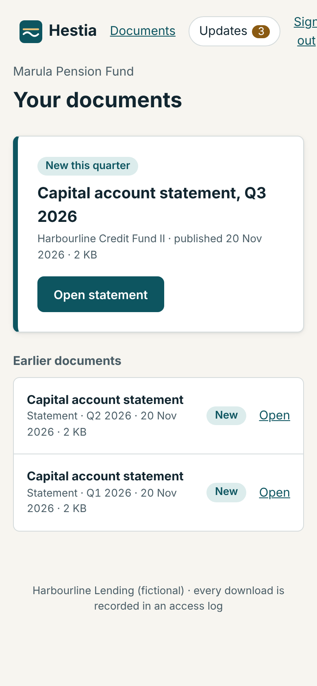

# Hestia

The investor portal for Harbourline Lending (a fictional lender). Fund investors get their statements in one place instead of as
email attachments, and Harbourline can say who opened which document, and when, in seconds.

## See it in action



| Your documents | Access log | Mobile |
|---|---|---|
|  |  |  |

Full-quality video: [docs/media/demo.mp4](docs/media/demo.mp4). Recorded from the running app with `demo/` (`cd demo && npm install && npm run record`).

## Design at a glance
Investors sign in (mostly on a phone) and open this quarter's statement in one tap; investor relations publish statements, revoke
access and read the access log. Every download is written to an append-only, hash-chained log before the file is sent.

**Architecture:** a modular monolith (Tenancy kernel, Investors, Documents) in one ASP.NET Core host, with a Blazor server-rendered UI
in the same app. Two engineers, a few hundred investors and quarter-end peaks of a few requests per second do not justify a
distributed system; the real risk is one investor seeing another's statements, so tenant isolation is enforced by one central filter
and proved by tests on every repository method and every API endpoint. Login, audit, notifications and web defaults come from
vendored Agentic building blocks. Full reasoning, capacity sums, diagrams and trade-offs (including why Blazor rather than React or
Angular): [`docs/DESIGN.md`](docs/DESIGN.md).

```mermaid
flowchart LR
  inv[Investor] -->|HTTPS cookie| app[Hestia<br/>ASP.NET Core + Blazor SSR<br/>Tenancy | Investors | Documents]
  ir[IR staff] -->|HTTPS cookie| app
  app --> files[(Files per tenant)]
  app --> log[(Append-only access log)]
```


## Run it in GitHub Codespaces

[](https://codespaces.new/Legion91919/hestia?quickstart=1)

The dev container installs the SDKs, restores packages and runs every test once on first start. The same setup works locally with VS Code's Dev Containers extension.

| What | Command | Port |
|---|---|---|
| API (Hestia) | `ASPNETCORE_ENVIRONMENT=Development ASPNETCORE_URLS=http://0.0.0.0:5203 dotnet run --project src/Hestia.Api` | 5203 |
| All tests (same as CI) | `scripts/test-all.sh` | - |

## What it does (slice 1)
- Investor view: newest statement first, earlier documents below, "New"/"Opened" status from the access log, live Updates badge.
- Investor A never sees investor B's documents (tenant from the signed-in user's claim; tested across every endpoint).
- Each download records who, what and when; IR can read the log per document or in the IR console.
- Revoking a user stops their access on the next request.
- Publishing a statement notifies that investor's users in the app.

## Run locally
```bash
ASPNETCORE_ENVIRONMENT=Development dotnet run --project src/Hestia.Api   # http://localhost:5203/login
dotnet test Hestia.sln
```
Demo users, the demo password and offline builds: [`.agentic/runbook.md`](.agentic/runbook.md).

## How this project is organised
`src/Hestia.Api` (host, endpoints, Blazor components in `Components/`, styles in `wwwroot/app.css`), `src/Modules/*` (one project per
module), `tests/Hestia.Tests` (unit, architecture, acceptance), `eng/packages` (vendored building blocks), `docs/DESIGN.md`.
Project knowledge lives in the hidden `.agentic/` folder (start with `.agentic/README.md`). AI agents read `AGENTS.md` first.

Built with the Baton model from the Agentic Engineering Kit: frame → map → decide → sketch → slice loop → pass the baton.
