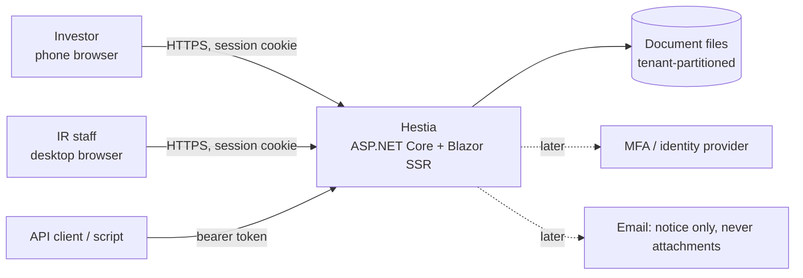
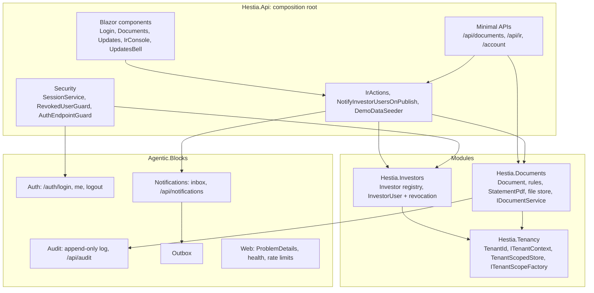
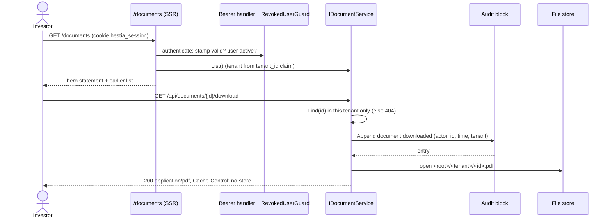
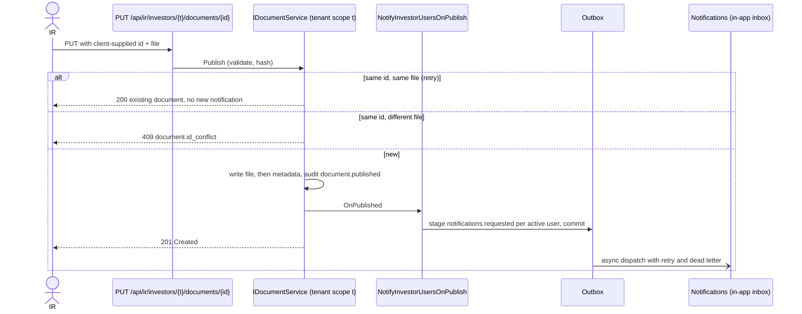
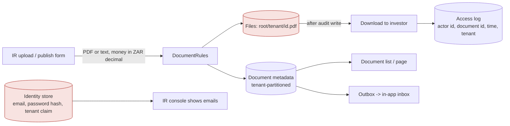
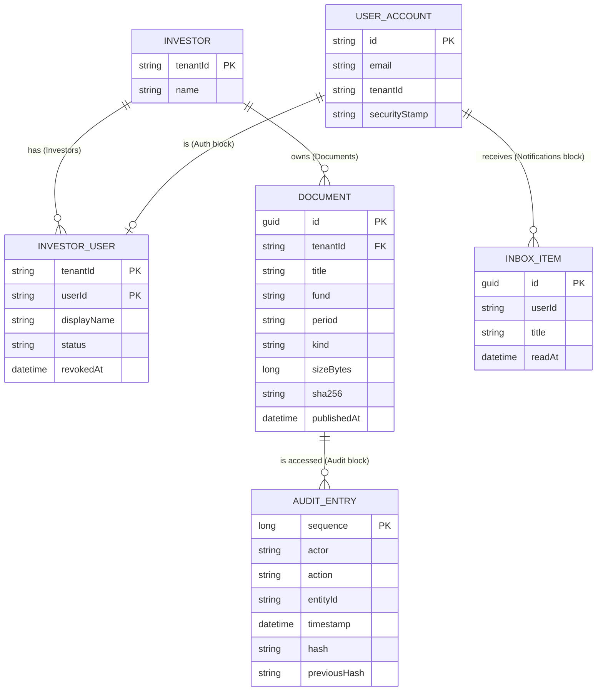

# Hestia: design dossier

> Harbourline Lending is a fictional company. All names, documents and numbers are invented.

## 1. Brief
- **Client:** Harbourline Lending, which runs private credit funds.
- **Problem:** fund investors (limited partners) get statements as email attachments, and nobody can say who opened what or when.
- **Users:** investor relations (IR) staff, weekly, on desktop; investors, quarterly, mostly on a phone.
- **Outcomes:** zero statements sent by email; the access log for any document is available in seconds.
- **Constraints:** POPIA; hosting in South Africa or the EU; MFA for investors (slice 3).

## 2. Requirements
**Functional (slice 1, built):**
1. An investor signs in and sees only their own investor entity's documents (`GET /api/documents`, `/documents`).
2. Every download writes who, what and when to an append-only access log before the file is sent.
3. A revoked user loses access on their next request and cannot sign in.
4. IR publishes a statement; every active user of that investor gets an in-app notification.

**Non-functional:**

| Quality | Target | Source |
|---|---|---|
| Availability | 99.9% per 30 days (43 min/month) | `.agentic/quality.md` |
| p95 latency, list and page | < 300 ms; download first byte < 500 ms | quality.md |
| Revocation | effective on the next request (0 s cache) | slice 1 criterion |
| Access log | append-only, hash-chained, kept 7 years (assumption: fund life + 5 years) | RegulatoryAudit trait |
| Privacy | no personal data in logs; investor contacts only in the identity store | POPIA |

## 3. Capacity estimate
Assumptions (rounded up): 400 investor entities, 3 users each = **1,200 users**; 6 documents per investor per quarter at ~100 KB.

- **Peak traffic:** quarter end, 80% of users open ~3 documents in 3 days = ~2,900 downloads + ~10k page views. Squeeze half into one
  busy hour: ~1.5 requests/s. One small instance handles 100x that.
- **Storage:** 400 x 6 x 4 x 100 KB = **~1 GB per year** of files. Access log: ~20k entries/year x 0.5 KB = 10 MB/year.
- **Bandwidth:** ~300 MB per quarter end, ~0.1 MB/s at the busy hour.
- **Uploads:** ~2,400 per quarter from IR, mostly in one week.

Numbers this small say: keep one deployable, put effort into isolation and audit, not into scale.

## 4. Options considered
`arch-advisor compare MultiTenant RegulatoryAudit PersonalData ReadHeavy SeveralBusinessAreas SmallTeam`:

| Option | Fit | Complexity (1-5) | Main reason |
|---|---|---|---|
| Modular monolith + CQRS read models | Recommended | 3 | Matches the advisor's recommended style (ModularMonolith). |
| Modular monolith | Good alternative | 3 | Same family as the recommendation; valid if its trade-offs suit the team. |
| Event-sourced core with CQRS | Good alternative | 4 | Same family; the event log is the audit trail. |
| Serverless functions + queues | Possible | 3 | Small team: low operational load. |
| Static site + serverless function | Poor fit | 1 | Real server-side behaviour and data. |
| Layered monolith | Poor fit | 1 | Several business areas would tangle without module boundaries. |
| Vertical slice monolith | Poor fit | 2 | Several business areas would tangle without module boundaries. |
| Clean Architecture monolith | Poor fit | 2 | Several business areas would tangle without module boundaries. |
| Microservices (request/response) | Poor fit | 5 | A small team can't run a distributed system well. |
| Event-driven microservices | Poor fit | 5 | A small team can't run a distributed system well. |

- **Chosen: modular monolith** (ADR-0001) with tenant isolation enforced centrally (ADR-0004). Documents, investors and later capital
  accounts and notices are separate modules; one deployment and one database suit two engineers.
- **CQRS read models: not yet.** At ~1.5 requests/s the "read model" is the document list itself. Add a cached read side when capital
  account reports arrive (slice 3), which is where reads get expensive.
- **Event sourcing: rejected for now.** Documents are immutable once published, and the Audit block already gives an append-only,
  hash-chained history. Event versioning would cost the team more than it gives.
- **Serverless:** quarter-end bursts fit, but the access-log-before-download rule and tenant filter are easier to prove in one process.
- **Microservices:** no team or load reason. **Global-scale answer:** at 100x, keep the monolith in each region (SA and EU for data
  residency) and serve files from a CDN with short-lived signed URLs issued after the audit write.
- **Evolve when (ADR-0001):** one module needs a different scale or release cadence; separate teams own modules; search becomes the bottleneck.

**Frontend: why Blazor here (ADR-0003).** The team is two .NET engineers, investors open one page four times a year on a phone,
and the riskiest code (tenant filter, audit) is server-side. Blazor static SSR keeps UI, API and rules in one C# codebase and one
build, ships no client bundle beyond `blazor.web.js`, and makes forms post back with antiforgery built in. Only the Updates badge
uses interactive server mode.

| | Blazor SSR (chosen) | React SPA | Angular SPA |
|---|---|---|---|
| Toolchain | .NET only, one CI job | npm + .NET, two jobs | npm + .NET, two jobs |
| First load on mobile | HTML only, ~190 KB script optional | JS bundle before content | larger bundle before content |
| Auth in the browser | HttpOnly cookie, server-rendered | tokens in JS or a BFF | tokens in JS or a BFF |
| Rich interactivity | limited (circuits cost server memory) | excellent | excellent |
| Hiring pool, component ecosystem | smaller | largest | large, enterprise |
| Testing | view models in xUnit + HTTP page checks (bUnit adds more) | Vitest + Testing Library | Jasmine/Jest + TestBed |

Trade-offs accepted: fewer UI libraries, server memory per interactive circuit, sessions tied to the access-token lifetime, and an
SPA team would find the patterns unfamiliar. If IR later needs a rich, offline-capable workspace, a React or Angular client can call
the same `/api` endpoints.

## 5. Architecture
**C4 context**

**C4 container / modules**

| Module | Owns | Public contract | May call |
|---|---|---|---|
| Tenancy (kernel) | tenant id, current tenant, the only tenant-owned data store | `ITenantContext`, `TenantScopedStore`, `ITenantScopeFactory` | nothing |
| Investors | investor entities (tenants), investor users and their access status | `IInvestorRegistry`, `IInvestorUserRepository` | Tenancy |
| Documents | document metadata, files, publish/download rules | `IDocumentService`, `IDocumentPublishedHandler` (port), `StatementPdf` | Tenancy, Audit block |
| Api host | pages, endpoints, cross-module wiring | HTTP | all modules and blocks |

Investors and Documents never reference each other (architecture test). The host joins them: for example
`NotifyInvestorUsersOnPublish` implements the Documents port using the Investors repository and the Notifications block.

## 6. Communication flows
**Slice 1: investor downloads a statement (synchronous)**

If the audit write fails, the file is not served (fail closed). Retrying a download is safe: it writes another entry, which is the truth.

**Riskiest flow: IR publishes, with retry**

Idempotency comes from the client-supplied document id; notifications go through the outbox so a slow channel never fails the publish.

**Revocation:** `POST /api/ir/investors/{t}/users/{u}/revoke` marks the user revoked and rotates their security stamp. Every
request runs the Auth block's stamp check and then `RevokedUserGuard`, so the next request is anonymous (401, or redirect to `/login`).

## 7. Data flow

Personal data (red): investor emails in the identity store, and the statements themselves (balances are personal financial data).
Money: closing balances live only inside statement files, as `decimal` via the `Money` type. The access log stores ids, not names.

## 8. Data model

Consistency: documents, users and revocation are strongly consistent (same process, same store); the audit append is strongly
consistent and ordered before the download; notifications are eventually consistent (outbox, seconds).

## 9. Scaling path
In the order things would break:
1. **Restart loses data** (in-memory stores): slice 2 moves to PostgreSQL (EF Core, global tenant filter + row-level security) and blob storage.
2. **Several instances:** persist the Data Protection key ring (tokens are data-protected) and use sticky sessions only for the Updates circuit.
3. **Quarter-end download spike:** after the audit write, redirect to a short-lived signed blob/CDN URL instead of streaming through the app.
4. **Capital account reports:** a cached read model per investor (the advisor's CQRS suggestion), rebuilt on publish.
5. **Two regions** for residency: one deployment per region, tenants pinned to a region.
6. **Extract** only a module whose load or cadence differs (for example document delivery).

## 10. Failure modes
| Failure | Effect | Mitigation |
|---|---|---|
| Audit store unavailable | downloads refused | fail closed by design; alert; readiness check in slice 2 |
| File missing on disk | 500 on download, entry already logged | integrity job comparing metadata with files (slice 2) |
| Duplicate publish (IR retry) | none | client-supplied id: 200 replay, 409 on different file |
| Notification channel down | none for IR or investor | outbox retry with back-off, dead letter |
| Poison notification | stuck message | dead letter after max attempts; visible in logs |
| Region outage | portal down | statements are not time-critical; restore from backups in the paired region (RTO 4 h) |
| Hot key (one big investor at quarter end) | slower downloads | CDN signed URLs (step 3 above) |
| Missing tenant filter in new code | data leak | impossible to compile around the store; architecture tests catch new repositories |
| Revoked user's open tab | next click fails | per-request check, no cache |

## 11. Security and privacy
- **AuthN:** Auth block (PBKDF2 600k, lockout after 5 failures). Browsers hold the opaque token in an HttpOnly, SameSite=Strict
  cookie; API clients send it as a bearer header. Self-registration is switched off. MFA is slice 3 (OIDC provider, ADR to follow).
- **AuthZ:** policy `investor` requires a `tenant_id` claim; policy `ir` requires the `ir` role; the audit API is IR-only.
  Tenancy is enforced in data access, not in endpoints (ADR-0004). Unknown or foreign document ids answer 404, never 403.
- **Revocation:** status check plus security-stamp rotation on every request.
- **Threats per flow:** download: IDOR (tenant-partitioned keys, 404), path traversal (tenant slug regex, Guid file names, root check).
  Sign-in: brute force (rate limit + lockout), open redirect (local return URLs only). Forms: CSRF (antiforgery + SameSite=Strict).
  Upload: type spoofing (PDF signature check, 10 MB cap, no executable types).
- **POPIA/GDPR:** minimum data (email and display name), audit holds ids only, no personal data in logs, hosting in SA or EU.
  Erasure: remove the identity and investor-user rows; access-log entries keep the opaque id (legal-hold basis).
- **Secrets:** none in the repo; demo password via environment (`.env.example`).

## 12. Observability
- **SLIs/SLOs:** API success rate 99.9%; p95 < 300 ms; download success 99.9%; audit-write failures 0.
- **Metrics:** downloads per minute, audit append latency, 401s after revocation, notification dead letters, outbox lag.
- **Traces and logs:** correlation id on every request (Web block), carried into every audit entry; ProblemDetails carry `traceId`.
- **The alert that wakes someone:** any audit-write failure (downloads are being refused), or download success < 99% for 10 minutes at quarter end.

## 13. Testing strategy
| Layer | What it covers here | Where |
|---|---|---|
| Rules | tenant ids, store isolation, document rules, statement PDF, revoke/restore | `tests/Hestia.Tests/Unit` |
| View models | `DocumentsPageModel` (what the Blazor page shows), without bUnit | `Unit/DocumentsPageModelTests.cs` |
| Boundaries | modules don't reference each other; internals stay internal; every repository goes through the tenant filter and refuses to run without a tenant (with a self-test that a leaky repository is caught) | `tests/Hestia.Tests/Architecture` |
| Acceptance (real HTTP, Kestrel) | each slice-1 criterion, every `/api` endpoint as the wrong investor, publish idempotency, notifications, rendered pages | `tests/Hestia.Tests/Acceptance` |
| Smoke | the app on port 5203 with curl | `.agentic/runbook.md` |

| Criterion | Tests |
|---|---|
| A never sees B's documents | `TenantIsolationTests` (list, every endpoint, page), `TenancyTests`, `TenantFilterTests` |
| Download logged who/what/when, append-only | `AccessLogTests` (4 tests) |
| Revoked user loses access immediately | `RevocationTests` (API, download, page, sign-in, restore) |
| New statement notifies in-app | `PublishAndNotifyTests` |

## 14. Interview questions
1. **How do you know investor A can't see B's statements?** Tenant comes only from the claim; all data goes through one tenant-partitioned
   store; tests fail if a repository bypasses it, and a test calls every API endpoint as B with A's ids.
2. **Why 404 and not 403 for someone else's document?** 403 confirms the document exists. 404 reveals nothing.
3. **What if the audit log is down?** Downloads stop. Serving a file we can't account for breaks the product's whole promise.
4. **How is "immediately" true for revocation?** Every request re-checks the user's status and security stamp; there is no cache to expire.
5. **IR clicks publish twice. What happens?** The client-supplied id makes the second call a 200 replay with no second notification.
6. **How would you handle 100x investors at quarter end?** Keep the audit write in the app, then redirect to a short-lived signed CDN URL.
7. **Why not event sourcing for an audit-heavy product?** Documents don't change after publishing; the hash-chained audit log already gives the history auditors need.
8. **Why Blazor and not React?** Two .NET engineers, a once-a-quarter mobile page and server-side risk. One codebase, one build, no token in JavaScript. A React client can still use `/api`.
9. **How does this become multi-region for POPIA?** One deployment per region, tenants pinned to a region, no cross-region data.
10. **How do you move to a real database without losing the guarantee?** The store becomes an EF Core global query filter plus PostgreSQL row-level security keyed on the same claim, and the same tests run against it.
